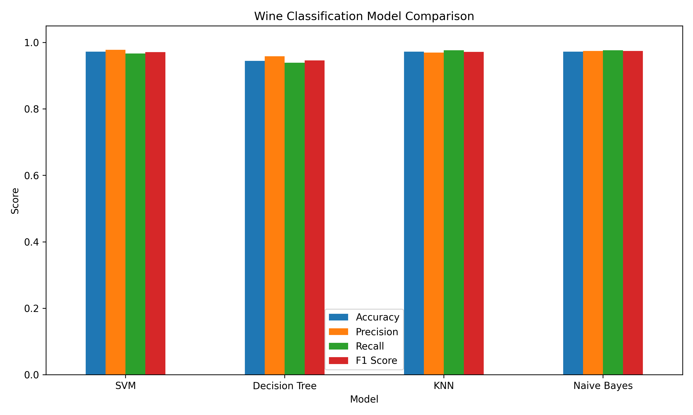
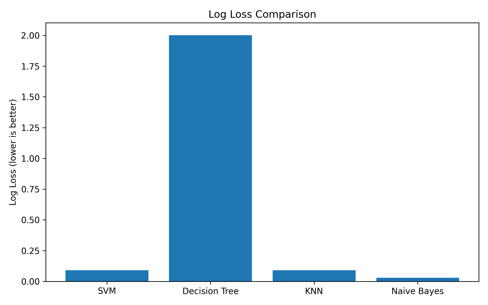

# Wine Classification – Model Comparison

**TY B.Tech. (AI & ML) – Practical 4: Classification Models**

Comparative performance evaluation of four classification algorithms – **SVM, Decision Tree, KNN and Gaussian Naïve Bayes** – on the Wine Recognition Dataset from scikit-learn.

## Problem Statement
Implement SVM, Decision Tree, KNN and Naïve Bayes classifiers on the Wine dataset, evaluate them using accuracy, precision, recall, F1-score and log loss, and compare their strengths and limitations.

## Dataset
| Item | Value |
|---|---|
| Source | `sklearn.datasets.load_wine()` (no download needed) |
| Samples | 178 |
| Features | 13 chemical measurements |
| Classes | 3 |
| Split | 80:20 stratified (142 train / 36 test), `random_state=42` |

## Models
| Model | Configuration |
|---|---|
| SVM | `StandardScaler` + `SVC(kernel="rbf", probability=True)` |
| Decision Tree | `max_depth=4` |
| KNN | `StandardScaler` + `n_neighbors=5` |
| Naïve Bayes | `GaussianNB()` |

Precision, recall and F1-score use **macro averaging** so all three classes count equally.

## Results
| Model | Accuracy | Precision | Recall | F1-score | Log Loss |
|---|---|---|---|---|---|
| SVM | 0.9722 | 0.9778 | 0.9667 | 0.9710 | 0.0906 |
| Decision Tree | 0.9444 | 0.9583 | 0.9389 | 0.9457 | 2.0024 |
| KNN | 0.9722 | 0.9697 | 0.9762 | 0.9718 | 0.0910 |
| Naïve Bayes | 0.9722 | 0.9744 | 0.9762 | 0.9743 | **0.0292** |

SVM, KNN and Naïve Bayes tie on accuracy (97.22%). Naïve Bayes has the best macro F1 and the lowest log loss; the Decision Tree is the weakest overall.




More screenshots (confusion matrices, console output) are in [`screenshots/`](screenshots/).

## How to Run
```bash
git clone https://github.com/YOUR-USERNAME/wine-classification-model-comparison.git
cd wine-classification-model-comparison
pip install -r requirements.txt
python wine_classification.py
```
The script prints all metrics and saves `wine_model_comparison.csv`, `performance_comparison.png`, `log_loss_comparison.png` and one confusion-matrix PNG per model in the working directory.

## Repository Structure
```
├── wine_classification.py      # main program
├── requirements.txt
├── sample_output.txt           # console output of one run
├── wine_model_comparison.csv   # metrics table
├── screenshots/                # graphs, confusion matrices, output
├── README.md
├── LICENSE
└── .gitignore
```

## Author
YOUR NAME – PRN: YOUR PRN – Division: YOUR DIVISION
